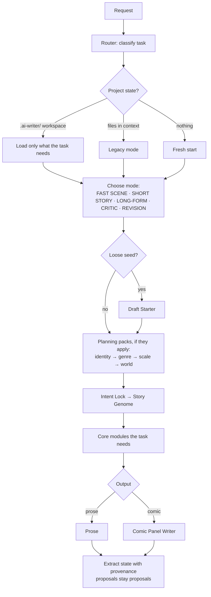

# AI Writer

**Audio drama extension, v0.9 (2026-11-23):** [Illustrated Audio Drama](packs/illustrated-audio-drama.md) scripts voiced episodes shown as motion comics: audio-first scripts, power signatures, and boards timed to locked audio. See its [research](research/packs/illustrated-audio-drama.md).
**Screenwriting extension, v0.8 (2026-09-26 10:03 PM CDT):** [Cinematic Scene Writer](packs/cinematic-scene-writer.md) adds full film scenes, timed music-video scripts and separate intention notes. See its [research](research/packs/cinematic-scene-writer.md).
A research-informed fiction-writing system for Claude Code.

AI Writer helps with story ideas, scenes, chapters, novels, series, origins, comics, mysteries, horror, romance, tragic and dark stories, worldbuilding, continuing existing projects, critique, and revision. It aims at fiction that is psychologically consequential, structurally coherent, and distinctive, not just polished.

It works as a small **kernel** that routes each request and loads only the machinery the task needs. A one-paragraph scene doesn't get a novel's worth of planning.

[](https://github.com/EZmannBuilds/ai-writer/actions/workflows/validate.yml)

Licensed [CC BY-NC 4.0](LICENSE.md): free to use, share, and adapt for non-commercial purposes.

---

## Installation

```bash
git clone https://github.com/EZmannBuilds/ai-writer.git ~/.claude/skills/ai-writer
```

Claude Code discovers the skill automatically. To update:

```bash
git -C ~/.claude/skills/ai-writer pull
```

---

## Basic use

Describe what you want. AI Writer classifies the request and picks what to load. You can also use trigger phrases:

| Say | Gets you |
|---|---|
| "Start Draft" | A short interview that turns a loose idea into a story brief |
| "Start Origin" | How a character became the hero, villain, or antihero they are |
| "Start Tragic Story" / "Dark Anime Mode" | Dark action and tragic fantasy where loss changes the story |
| "Start Mystery" | A fair, solvable mystery built from a hidden truth |
| "Start Horror" | Dread shaped as a curve, with a threat that's dangerous and wrong |
| "Start Romance" | Relationships tracked from each partner's side |
| "Start Series" | Multi-book or multi-season planning |
| "Build World" | Societies and systems that land on people as cost and conflict |
| "Comic Mode" | Comic-book visual logic, or page and panel scripts |

Plain requests work too: "write the scene where...", "continue chapter 9", "give me notes on this", "tighten this chapter".

**"You decide"** is always an answer. AI Writer makes the choice, labels it as a delegated decision, and keeps going.

---

## Quick example

> **You:** Let's make a heartfelt story about skiing.

AI Writer recognizes a loose seed and opens Draft Starter. It offers a few readings (a family returning to a mountain they once loved; a mentor who can't keep doing the thing that defined them), then asks three to five questions, starting with what the story should feel like.

> **You:** Parent and child. Bittersweet. The mountain is a memory she's been avoiding. You decide the rest.

It writes a Draft Brief that keeps your three answers **confirmed** and labels everything it invented as **delegated**. Then it locks intent, generates structurally different candidates, builds the story's genome, and drafts.

> **You:** Write the scene where she finally rides the lift alone.

This is a defined scene, so AI Writer switches to **FAST SCENE MODE**. It reads what it already knows, builds a scene contract, and writes the scene. No new interview, no replanning.

---

## Runtime architecture



```text
SKILL.md     kernel: principles, runtime, index, guardrails
runtime/     router, project state, workspace, canon resolver
core/        22 focused modules, loaded on demand
packs/       9 optional packs with front-matter contracts
research/    sources, what each supports, limits, benchmark
tests/       35 behavioral fixtures, 7 workflow traces, run results
docs/        pack authoring guide, v0.5 → v0.6 migration map
templates/   pack template, workspace starter files
scripts/     repository validation
```

### Core vs packs

**Core modules** hold mechanisms any story might need: intent, story identity, candidate search, character minds and agency, relationships, world state, memory, continuity, outlining, scenes, reader state, suspense/curiosity/surprise, information and reveals, dialogue, POV, prose, revision, critics, endings, and research mode. Each opens with a contract: who invokes it, when, what it needs and produces, where its state lives, when to skip it, and which tests cover it.

**Packs** are optional. Each declares its triggers, skip conditions, dependencies, inputs, outputs, state, research basis, and tests in YAML front matter. The router reads that front matter without loading the pack.

### Canon and provenance

Every fact carries a status: user-confirmed, source canon, approved inference, delegated decision, agent proposal, uncertain, in-world belief, character belief, alternate continuity, deprecated, or retcon. A [canon resolver](runtime/canon-resolver.md) decides what wins in a conflict, checks whether a contradiction is intentional (an unreliable narrator, a myth, a planted clue) before calling it an error, and **never lets an agent's proposal become canon without you**.

---

## Persistent project mode

For long projects, AI Writer can keep state in a `.ai-writer/` folder in your project: canon, characters, relationships, world, timeline, outline, open loops, setups and payoffs, pack ledgers, and short summaries. The files are plain YAML and Markdown, meant to be read and edited.

- **Optional.** Without it, AI Writer works from the files and conversation you provide.
- **Asked for, never assumed.** It offers a workspace when a project gets big; it doesn't create one on its own.
- **Your files stay primary.** The workspace indexes your manuscript; it doesn't copy it.
- **Selective.** Each request loads only the records it touches.

See [runtime/workspace.md](runtime/workspace.md) and [templates/workspace/](templates/workspace/).

---

## Available packs

| Pack | Stage | What it does |
|---|---|---|
| [Draft Starter](packs/draft-starter.md) | front door | Turns a loose seed into a Draft Brief with 3–5 consequential questions |
| [Origin Forge](packs/origin-forge.md) | identity | Separates the event that breaks someone from the choice that defines them; military and moral-conflict module |
| [Tragic Anime Story Engine](packs/tragic-anime-engine.md) | genre | Hope reserves, consequence ledgers, the death-necessity test, reveal chains |
| [Mystery / Investigation](packs/mystery.md) | genre | Truth model, two-meaning clues, suspects with real secrets, false solutions, fairness tests |
| [Horror / Dread](packs/horror.md) | genre | Dread curves with quiet, threat models, rule uncertainty, an anti-cliché audit |
| [Romance / Attachment](packs/romance.md) | genre | Per-partner perception, love as separate dimensions, disclosure ladders, endings that fit |
| [Series / Season Engine](packs/series-engine.md) | scale | Promise stacks, long threads with partial payoffs, escalation beyond bigger villains |
| [Society / Worldbuilding](packs/worldbuilding.md) | world | Causal chains from world conditions to personal consequences |
| [Illustrated Audio Drama](packs/illustrated-audio-drama.md) | output | Audio-first episode scripts, power signatures, boards timed to locked audio, audio-visual audits |
| [Comic Panel Writer](packs/comic-panel-writer.md) | output | Comic narrative, page maps, panel breakdowns, full scripts, lettering audits |

---

## How research is used

Research findings are **tools and diagnostics, not commandments**. They widen the options and catch AI defaults; they never override what you want. A children's story can state its moral. A romance can end apart.

Every research-derived mechanism records its source, what the source actually claims, what AI Writer takes from it, its limitations, and its **fidelity**: whether the skill does what the source does, only approximates it (many sources rely on embeddings, classifiers, decoding changes, or multiple models that a text-only skill doesn't have), borrows it as an idea, or follows a convention. Where no source exists, the design says so.

Start at [research/README.md](research/README.md). All sources are listed in [research/source-index.md](research/source-index.md).

---

## Testing philosophy

AI Writer's tests check **behavior and invariants**, not taste:

- a loose seed opens Draft Starter, and a detailed scene skips it;
- "you decide" is delegation;
- proposals never silently become canon;
- characters act only on what they know;
- a death leaves residue, and survival is considered first;
- a mystery's reveal rests on prior clues;
- a comic panel is drawable;
- user intent beats every heuristic.

There are 35 fixtures in [tests/fixtures/](tests/fixtures/), each run by an executor agent and graded by a separate agent; see [tests/README.md](tests/README.md). The [latest run](tests/results/2026-09-16.md) passes all 35 after three rounds, and records what failed along the way and what changed. [Seven end-to-end workflows](tests/workflow-traces.md) are traced step by step.

Whether AI Writer makes fiction **better** is a separate question, for the [benchmark](research/benchmark.md): blinded, human, pairwise comparison against the same model without the skill. Automated checks may help with continuity and repetition; they never judge beauty, voice, or originality.

CI runs `scripts/validate.py` on every push. It checks links, anchors, pack contracts, fixtures, YAML, stale references, and research provenance.

---

## Pack authoring

Want to add a genre or a capability? Read [docs/PACK_AUTHORING.md](docs/PACK_AUTHORING.md) and start from [templates/PACK_TEMPLATE.md](templates/PACK_TEMPLATE.md). The guide covers when something should be a pack, the contract, state rules, research provenance, tests, and the anti-patterns to avoid.

---

## Upgrading from v0.5

v0.5 was one 93 KB file with numbered sections. [docs/MIGRATION.md](docs/MIGRATION.md) maps every old section to its new home. Old trigger phrases still work, and existing projects need no migration. See the [CHANGELOG](CHANGELOG.md).

---

## License

[CC BY-NC 4.0](LICENSE.md). Share and adapt AI Writer for non-commercial purposes, with attribution. The license covers AI Writer's own material; the author claims no rights in the fiction you write with it. The [license page](LICENSE.md) explains the details; the legal code is authoritative.
